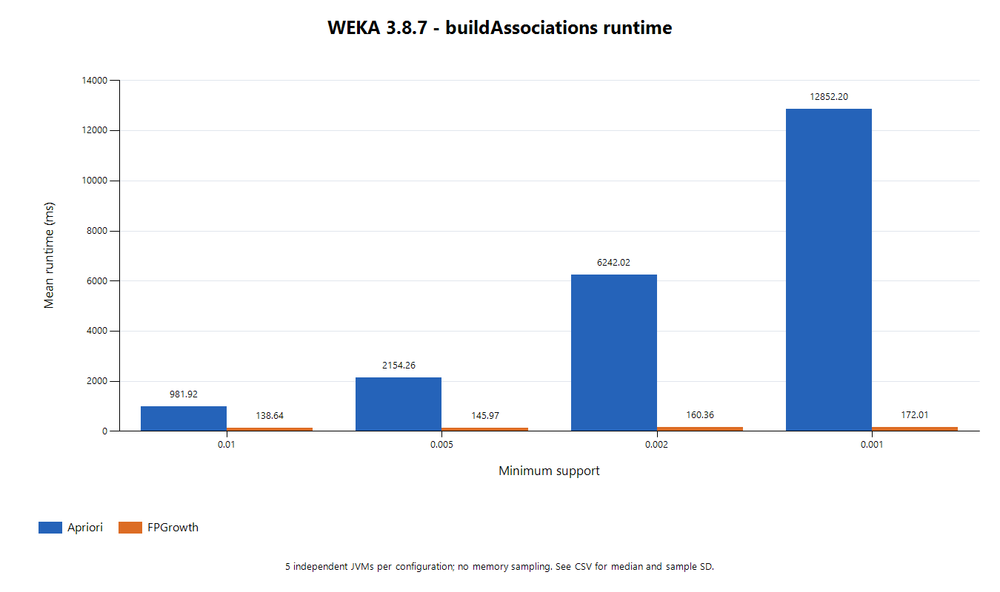
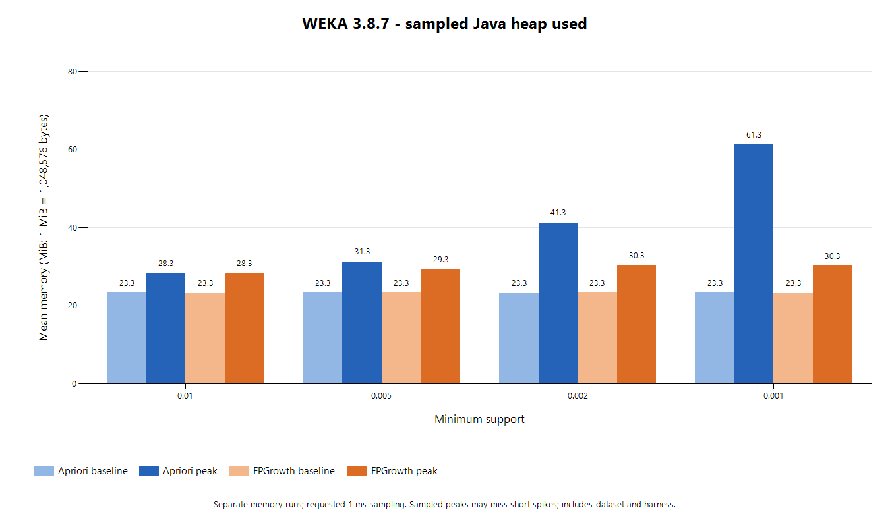
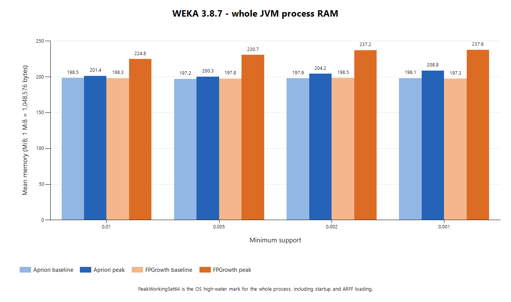

# Supermarket Market Basket Analysis

Bài tập lớn môn **Khai phá dữ liệu**, phân tích các sản phẩm thường xuất hiện cùng nhau trong giỏ hàng siêu thị bằng **WEKA 3.8.7**.

Tiền xử lý và khai phá luật được thực hiện trong **WEKA Explorer**. Công cụ Java trong repository dùng trực tiếp `weka.associations.Apriori` và `weka.associations.FPGrowth` để benchmark trên cùng dữ liệu và cấu hình đã chạy trong Explorer.

## Dữ liệu

Nguồn: [Groceries dataset — Heeral Dedhia, Kaggle](https://www.kaggle.com/datasets/heeraldedhia/groceries-dataset). Chủ dự án xác nhận đã tải, giải nén bộ dữ liệu này rồi xử lý bằng WEKA.

| Chỉ tiêu | Kết quả xác minh từ các file ARFF |
|---|---:|
| Bản ghi mức sản phẩm trong `groceries_sorted.arff` | 38.765 |
| Khách hàng phân biệt | 3.898 |
| Sản phẩm | 167 |
| Giỏ hàng theo `Member_number` và `Date` | 14.963 |
| Ma trận giỏ hàng × sản phẩm | 14.963 × 167 |
| Lượt xuất hiện sản phẩm phân biệt theo giỏ | 38.006 |

`groceries_basket.arff` là đầu vào benchmark, mỗi thuộc tính có hai giá trị `{f,t}`. CSV gốc không có trong repository; số dòng trên được đếm từ ARFF trung gian. `Date` trong file trung gian đã được mã hóa số nên chưa đối chiếu lại ngày lịch ban đầu.

Chi tiết nguồn, các bước xử lý được lưu trong tên relation và SHA-256: [docs/DATA_SOURCES.md](docs/DATA_SOURCES.md).

## Chạy benchmark

Yêu cầu: **Windows**, **Windows PowerShell 5.1 trở lên**, **WEKA 3.8.7** và **JDK có `javac`**. Cấu hình đã kiểm tra là JDK Temurin 25.0.1 để biên dịch và Java BellSoft 25.0.2 đi kèm WEKA để thực thi.

Mở PowerShell tại thư mục gốc repository:

```powershell
java -version
javac -version
powershell -NoProfile -ExecutionPolicy Bypass -File .\benchmark_weka\Run-Benchmark.ps1
```

Script tự tìm thư viện WEKA đã cài và xác nhận đúng phiên bản. Nếu có nhiều bản cài hoặc WEKA nằm ở vị trí khác, truyền đường dẫn thực tế:

```powershell
powershell -NoProfile -ExecutionPolicy Bypass -File .\benchmark_weka\Run-Benchmark.ps1 -WekaJar "D:\duong-dan-thuc-te\weka.jar"
```

Có thể thêm `-Repetitions 10`, `-Java "...\java.exe"`, `-Javac "...\javac.exe"` hoặc `-MaximumHeap 4g`. Thư viện WEKA được dùng từ bản cài trên máy; repository không kèm `weka.jar`.

Mặc định có **80 JVM riêng**: 2 thuật toán × 4 support × 5 lần lặp × 2 đợt runtime/memory. Mỗi lần chạy tạo một thư mục kết quả mới. Hướng dẫn đầy đủ: [benchmark_weka/README.md](benchmark_weka/README.md).

## Cấu hình và cách đo

- Support: **0.01, 0.005, 0.002, 0.001**; confidence benchmark: **0.05**.
- Apriori: `treatZeroAsMissing=true`, `numRules=1000`, `upperBoundMinSupport=1.0`, `delta=1.0-support`, tắt verbose và xuất tập mục.
- FP-Growth: `positiveIndex=2`, `findAllRulesForSupportLevel=true`, `maxNumberOfItems=-1`, `upperBoundMinSupport=1.0`.
- Runtime: `System.nanoTime()` đặt sát lời gọi `buildAssociations()`, loại trừ đọc ARFF, khởi động JVM và xuất kết quả. Đây là lần gọi đầu trong mỗi JVM, gồm ảnh hưởng nạp lớp/JIT phát sinh bên trong lời gọi.
- Java Heap: đợt riêng, lấy mẫu `MemoryMXBean` với khoảng nghỉ yêu cầu **1 ms**; lưu baseline, sampled peak và khoảng lấy mẫu thực tế.
- RAM toàn JVM: `WorkingSet64` làm baseline và `PeakWorkingSet64` làm mốc đỉnh toàn tiến trình; theo dõi với khoảng nghỉ yêu cầu **5 ms**. Chỉ số này gồm cả JVM, nạp dữ liệu và mã đo, khác với heap dùng.

Không dùng thời gian của đợt memory để so sánh tốc độ; không dùng RAM cuối trừ RAM đầu làm bộ nhớ đỉnh.

## Kết quả chính

Kết quả tham chiếu: [run_20261113_224427_764_9d8ed359](benchmark_weka/results/run_20261113_224427_764_9d8ed359/), đo ngày **13/11/2026**. Các giá trị thời gian dưới đây là trung bình 5 lần chạy.

| Min Support | Luật Apriori | Luật FP-Growth | Apriori ms | FP-Growth ms | Tỷ số thời gian Apriori / FP |
|---|---:|---:|---:|---:|---:|
| 0.01 | 10 | 10 | 981,92 | 138,64 | 7,08 lần |
| 0.005 | 57 | 57 | 2.154,26 | 145,97 | 14,76 lần |
| 0.002 | 219 | 219 | 6.242,02 | 160,36 | 38,92 lần |
| 0.001 | 450 | 450 | 12.852,20 | 172,01 | 74,72 lần |

Apriori và FP-Growth cho cùng tập luật ở từng cấu hình đã lưu. Khi giữ support 0.001 và tăng confidence từ 0.05 lên 0.10 rồi 0.20, số luật lần lượt là **450, 131 và 2**.

FP-Growth nhanh hơn trong thực nghiệm này. Tại support 0.001, heap đỉnh lấy mẫu trung bình là **30,26 MiB** với FP-Growth và **61,29 MiB** với Apriori; RAM đỉnh toàn JVM lần lượt là **237,64 MiB** và **208,79 MiB**. Vì vậy, kết luận về tốc độ và heap cần tách khỏi kết luận về RAM toàn tiến trình.

Đây là kết quả trên một dataset và cấu hình máy cụ thể, với 5 lần lặp và không kiểm soát hoạt động nền. Máy có 15,729 GiB RAM vật lý nhưng chỉ còn 1,015 GiB khả dụng lúc bắt đầu; xem giới hạn đầy đủ trong [benchmark_methodology.md](benchmark_weka/results/run_20261113_224427_764_9d8ed359/benchmark_methodology.md).

### Tệp kết quả

- [benchmark_raw.csv](benchmark_weka/results/run_20261113_224427_764_9d8ed359/benchmark_raw.csv): 80 lượt đo.
- [benchmark_summary.csv](benchmark_weka/results/run_20261113_224427_764_9d8ed359/benchmark_summary.csv): trung bình, trung vị, độ lệch chuẩn mẫu, min/max, baseline và peak.
- [environment.json](benchmark_weka/results/run_20261113_224427_764_9d8ed359/environment.json): phiên bản, cấu hình máy và JVM.
- [runs/](benchmark_weka/results/run_20261113_224427_764_9d8ed359/runs/): JSON từng lượt và tập luật `.rules.tsv` để đối chiếu.







## Tài liệu trình bày

- [Tổng hợp kết quả Word](TongHop_KetQua_MarketBasket.docx): 11 bảng và 2 biểu đồ, có nguồn dưới từng bảng.
- [Slide thuyết trình](slide/DataMining.pptx).
- [11 ảnh bảng PNG 300 dpi](presentation_tables/), hoặc [tải bộ ảnh ZIP](presentation_tables.zip).
- Các file `Apriori_Support_*.txt`, `FPGrowth_Support_*.txt`, `Apriori_Confidence_*.txt`, `FPGrowth_Confidence_*.txt`: kết quả xuất trực tiếp từ Explorer.

Support, confidence và lift trong bảng luật được tính lại từ số giỏ khi có đủ căn cứ. Với support 0.001 và confidence 0.05 có **94 luật Lift > 1**; trong đó 6 luật được WEKA hiển thị Lift 1.00 do làm tròn. Các đề xuất cross-selling, combo và trưng bày là phương án thử nghiệm, chưa chứng minh tác động doanh thu hay quan hệ nhân quả.

## Cấu trúc repository

```text
.
├── README.md
├── .gitignore
├── .gitattributes
├── docs/
│   ├── DATA_SOURCES.md
│   ├── LICENSE_NOTES.md
│   └── GITHUB_SETUP.md
├── groceries_basket.arff
├── groceries_sorted.arff
├── Apriori_*.txt
├── FPGrowth_*.txt
├── benchmark_weka/
│   ├── WekaBenchmark.java
│   ├── Run-Benchmark.ps1
│   ├── Create-Charts.ps1
│   ├── README.md
│   └── results/run_20261113_224427_764_9d8ed359/
├── TongHop_KetQua_MarketBasket.docx
├── presentation_tables/
├── presentation_tables.zip
└── slide/DataMining.pptx
```

`.gitignore` giữ một lần benchmark tham chiếu đã xác minh và bỏ qua các lần chạy mới, lượt thử lỗi, `.class`, log, file đồng bộ và dữ liệu QA. Muốn đưa một lần chạy mới vào Git, thêm ngoại lệ tương ứng trong `.gitignore` sau khi kiểm tra kết quả. `.gitattributes` giữ nguyên byte của ARFF, kết quả WEKA và thư mục benchmark tham chiếu để bảo toàn SHA-256.

## Nguồn và giấy phép

Theo lựa chọn của chủ dự án ngày **20/11/2026**, **chưa cấp license riêng cho mã benchmark**. Nguồn dataset đã được xác nhận; loại license cụ thể trên Data Card Kaggle chưa được xác minh trong tài liệu của repository. WEKA là phần mềm bên thứ ba với giấy phép riêng.

Xem [nguồn dữ liệu](docs/DATA_SOURCES.md) và [trạng thái giấy phép](docs/LICENSE_NOTES.md). Hướng dẫn tự commit và push: [docs/GITHUB_SETUP.md](docs/GITHUB_SETUP.md).
